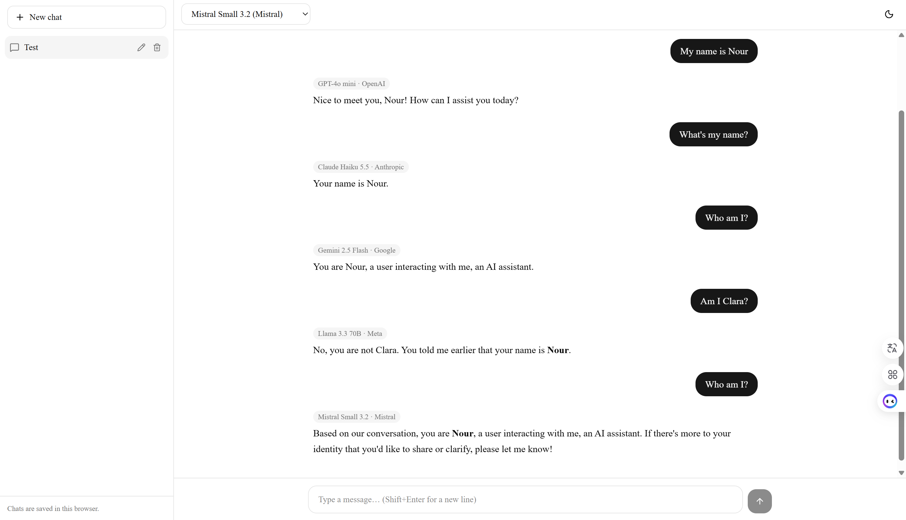

# AI Chat – Multi-Model Chat App

A chat application that connects to multiple LLM providers through **OpenRouter**. You can switch models **in the middle of a conversation** without losing context: the full message history is sent to whichever model you choose.

**Live demo:** https://ai-chat-app-six-bice.vercel.app

## Features

- **Streaming responses**: replies appear token by token as they're generated
- **5 models from 5 providers**, selectable from a dropdown
- **Mid-conversation model switching**: the new model receives the full history, so context is kept
- **Model label on every reply**: shows which model produced each response
- **Markdown and code-block rendering** (headings, lists, tables, code)
- **Conversation management**: create, rename, delete, and reopen chats (saved in browser `localStorage`)
- **Error handling**: clear messages for rate limits (429), unavailable models, missing credits, and provider errors, with a **Retry** button and a **Stop** button
- **Context trimming**: only the last 20 messages are sent, so long chats stay within the context window
- **Responsive UI** with a slide-out sidebar on mobile
- **Light and dark mode** (follows the system setting, with a manual toggle)
- **Secure API key handling**: the key is only used in a server-side route and stored as a Vercel Environment Variable

## Models used

| Model | Provider | OpenRouter ID |
|---|---|---|
| GPT-4o mini | OpenAI | `openai/gpt-4o-mini` |
| Claude Haiku 5.5 | Anthropic | `anthropic/claude-haiku-5.5` |
| Gemini 2.5 Flash | Google | `google/gemini-2.5-flash` |
| Llama 3.3 70B Instruct | Meta | `meta-llama/llama-3.3-70b-instruct` |
| Mistral Small 3.2 24B | Mistral | `mistralai/mistral-small-3.2-24b-instruct` |

## Context is kept when switching models


LLM APIs are stateless: the model doesn't remember earlier messages. On every turn, the app sends the **entire conversation** to the server route, which forwards it to the selected model. So when you switch models, the new model sees everything said before.

In the example below, the name was given to **GPT-4o mini**, and **Gemini 2.5 Flash** answered correctly after the switch:



## Tech stack

- **Next.js** (App Router) + **TypeScript**
- **Tailwind CSS** + **shadcn/ui**
- **Vercel AI SDK** (`ai`, `@ai-sdk/react`) with the **OpenRouter provider**
- **Vercel** (Hobby plan) for hosting
- **localStorage** for saving conversations

## How it works

```
Browser (app/page.tsx, components/chat.tsx)
   │  sends full message history + selected model
   ▼
Server route (app/api/chat/route.ts)   ← API key lives only here
   │  checks the model is allowed, trims history, calls OpenRouter
   ▼
OpenRouter  →  OpenAI / Anthropic / Google / Meta / Mistral
   │  streams the reply back
   ▼
Browser renders the reply live, labeled with the model name
```

## Setup (run locally)

1. **Clone the repo**

```bash
   git clone https://github.com/nourrmahdi/ai-chat-app.git
   cd ai-chat-app
```
2. **Install dependencies**
```bash
   npm install
```
3. **Add your API key.** Copy `.env.example` to `.env.local` and add your OpenRouter key:
```
   OPENROUTER_API_KEY=your-key-here
```
   `.env.local` is git-ignored and is never committed.
4. **Start the dev server**
```bash
   npm run dev
```
   Open http://localhost:3000.

## Deploying to Vercel

1. Import the GitHub repo at vercel.com/new.
2. Under **Environment Variables**, add `OPENROUTER_API_KEY`.
3. Click **Deploy**. Every push to `main` redeploys automatically.

## Security

- The API key is **only** read in `app/api/chat/route.ts`, which runs on the server.
- It's stored in `.env.local` locally (git-ignored) and as a **Vercel Environment Variable** in production.
- It is never in the repository or in client-side code.
- The server only accepts models from an allow-list, so the key can't be used for other models.


## Known limitations

- **Chats are stored in the browser** (`localStorage`): they don't sync across devices and are lost if browser data is cleared.
- **Simple history trimming**: only the last 20 messages are sent, so very old messages in a long chat are forgotten. A better approach would count tokens or summarize older messages.
- **Model availability depends on OpenRouter**: models can be retired (Claude 3.5 Haiku and Gemini 2.0 Flash were retired during development and had to be replaced).
- **Text only**: no image or file uploads.
- **No user accounts or authentication.**
- **Rename and delete** use the browser's built-in prompt and confirm dialogs.
- **30-second limit** per reply on the Vercel Hobby plan, so very long answers may be cut off.