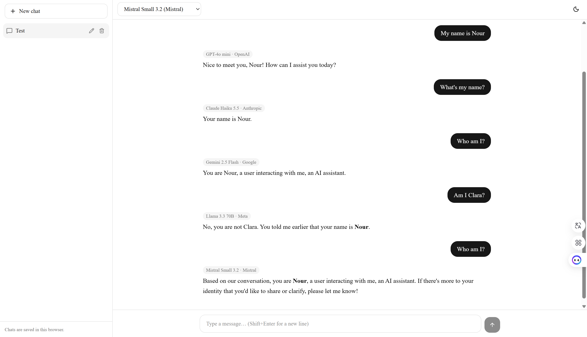

# AI Chat – Multi-Model Chat with Images and Files

A chat application connected to many LLM providers through **OpenRouter**. You can switch models **in the middle of a conversation** without losing context, upload images for the AI to analyze, ask it to **create and edit images**, and upload **documents** (PDF, Word, Excel/CSV, code, text) to ask questions about them, summarize and compare them, **extract structured data**, and get back **generated or edited files** to download. The chat model decides by itself which tools to use, through **tool calling**.

**Live demo:** https://ai-chat-app-six-bice.vercel.app

---

## Features

### Chat (Project 2)
- **Streaming responses**: replies appear token by token
- **5 chat models from 5 providers**, selectable from a dropdown
- **Mid-conversation model switching**: the full history is sent to the new model, so context is kept
- **Model label on every reply**, showing which model produced it
- **Markdown and code-block rendering**
- **Conversation management**: create, rename, delete, and reopen chats (saved in browser `localStorage`)
- **Error handling**: clear messages for rate limits, unavailable models, missing credits, too-long conversations, and provider errors, with **Retry** and **Stop** buttons
- **Context trimming**: only the last 20 messages are sent
- **Generation parameters**: temperature 0.7, max 4,000 output tokens per reply (raised from 1,000 so the model can write whole files)
- **Responsive UI** (slide-out sidebar on mobile) with **light and dark mode**

### Images (Project 3)
- **Image upload** by **drag-and-drop**, **paste (Ctrl + V)**, or **file picker**, with **previews** and upload spinners
- **Image understanding** with vision models: description, analysis, **text extraction (OCR)**, questions about an image, and **comparing several images**
- **Image generation** from text or from a reference image, with **Edit**, **Regenerate**, **Variation**, and **Download** buttons
- **Capability detection**: the model list shows which models are **vision** or **text only**; text-only models get a text note instead of the image
- **Large images are shrunk in the browser** (max 1600 px) before upload

### Files and documents (Project 4)
- **Upload documents** with the same paperclip, drag-and-drop, or paste: **PDF**, **Word (.docx)**, **Excel (.xlsx)**, **CSV**, **code files** (.py, .js, .ts, .java, .c, .cpp, .sql, .json, …) and **text / Markdown**. Images and documents can be mixed in the same message.
- **Parsing on upload**: the text is extracted (PDF pages are labeled, Word headings, lists and tables keep their structure, every Excel sheet is read), split into parts, and indexed. The upload chip shows e.g. "184 pages · indexed".
- **Ask questions** about one or several documents. Answers name the document and section they come from, and the model says so when the documents don't contain the answer.
- **Summarize** any document, including documents far bigger than the model's context.
- **Compare** several documents in one question.
- **Structured extraction** (`extractData`): the model chooses the fields, and a **Zod schema** built from them forces the output to be valid JSON. The result is shown as a table, with the raw JSON, and can be saved as **Excel, CSV or JSON**.
- **Exact spreadsheet calculations** (`analyzeTable`): totals, averages, counts, min and max, filtered and grouped (e.g. "revenue per region"), computed **in code** on the real file instead of by the model, so numbers are always correct. Results can be saved as Excel or CSV.
- **File generation with download** (`createFile`): **Word (.docx)**, **PDF**, **Excel (.xlsx)**, **CSV**, **Markdown**, **text** and **code** files, with headings, bullet points, bold text and tables.
- **Edited files**: ask for changes to an uploaded file (e.g. "fix the bug in this script", "rewrite this report more formally") and get the new version back as a file.
- **Large documents** are handled with **RAG**: embeddings stored in **Supabase pgvector**, **hybrid search** (meaning + keywords), **part-by-part reading**, and **map-reduce summaries**, so a 184-page PDF (~160k tokens) works even with GPT-4o mini (128K context).
- **Visible agent steps**: the chat shows what the model did, e.g. "Searched documents for 'vacation days' · 8 passages found · pgvector" or "Summarized 'handbook.pdf' in 12 sections".
- **Works across models**: documents stay in the conversation when switching models, and even the **text-only Llama** model can use them, because models receive text, not the original file.

---

## Models used

### Chat models (in the dropdown)
| Model | Provider | OpenRouter ID | Vision |
|---|---|---|---|
| GPT-4o mini | OpenAI | `openai/gpt-4o-mini` | ✅ |
| Claude Haiku 5.5 | Anthropic | `anthropic/claude-haiku-5.5` | ✅ |
| Gemini 2.5 Flash | Google | `google/gemini-2.5-flash` | ✅ |
| Llama 3.3 70B Instruct | Meta | `meta-llama/llama-3.3-70b-instruct` | ❌ text only |
| Mistral Small 3.2 24B | Mistral | `mistralai/mistral-small-3.2-24b-instruct` | ✅ |

All five can use documents and every tool.

### Models used by the tools
| Purpose | Model | OpenRouter ID |
|---|---|---|
| Image generation | Gemini 2.5 Flash Image | `google/gemini-2.5-flash-image` |
| Embeddings (semantic search) | OpenAI text-embedding-3-small (512 dimensions) | `openai/text-embedding-3-small` |
| Section summaries and structured extraction | Gemini 2.5 Flash | `google/gemini-2.5-flash` |

---

## How it works

```
Browser (components/chat.tsx)
  │  Images    → /api/upload → Vercel Blob
  │  Documents → /api/files  → parse → split into parts → embeddings
  │                             → Supabase pgvector (one row per part) + Vercel Blob (file + backup)
  │  The message (text + file URLs) and the full history are sent with the chosen model
  ▼
/api/chat (server)                                   ← API keys live only here
  │  • Small documents (≤ 30,000 characters): full text is put in the prompt
  │  • Large documents: only a note, the model must use the document tools
  │  • Images: base64 for vision models, a text note for text-only models
  │  • Gives the model 7 tools and allows up to 6 steps per answer
  ▼
Chat model (via OpenRouter) decides what to do, for example:
  searchDocuments → readDocument → createFile → final answer
  ▼
Tools (server, lib/tools.ts)
  │  generateImage      image generation / editing (Project 3)
  │  searchDocuments    hybrid search (pgvector + keywords) over the chat's documents (RAG)
  │  readDocument       reads a document part by part, in order
  │  summarizeDocument  map-reduce summary of a whole document
  │  extractData        structured JSON extraction with a Zod schema
  │  analyzeTable       exact totals / averages / counts on Excel and CSV
  │  createFile         builds .docx / .pdf / .xlsx / .csv / .md / code → Blob
  ▼
Browser shows the answer, the agent steps, tables, and Download buttons
```

### Parsing
| Format | Library | What is kept |
|---|---|---|
| PDF | `unpdf` | text of each page, labeled `[Page n]` |
| Word (.docx) | `mammoth` | headings, lists, tables |
| Excel (.xlsx) | `exceljs` | every sheet, every row (formula results, dates) |
| CSV, code, text, Markdown | built in | the raw text (code is labeled with its language) |

Scanned PDFs (images of text, no selectable text) are detected and the user is asked to upload them as images instead, so a vision model can read them.

### Large documents (RAG with Supabase pgvector)
1. **Chunking**: the text is split into parts of about 1,200 characters with a 150-character overlap, cutting at line breaks when possible.
2. **Embeddings**: each part is turned into a vector of 512 numbers with `text-embedding-3-small`, in batches.
3. **Vector store**: every part is saved as a row in a **Supabase (Postgres) table with a pgvector column** (`document_chunks`: document URL, name, part number, text, embedding). The original file and the full text are kept in **Vercel Blob**.
4. **Hybrid retrieval**: `searchDocuments` embeds the question and calls a Postgres function (`match_document_chunks`) that scores every part of the chat's documents by
   - **meaning**: cosine similarity computed by pgvector (70%), and
   - **exact words**: Postgres full-text search, where **rare words count more** than common ones (30%).

   The model sends **2–4 phrasings** of each question (the user's words plus the formal terms a document would use, e.g. "bring my dog" → "pets policy"). The ranked lists are merged with **reciprocal rank fusion**, so passages that rank high for several phrasings win, and the 8 best passages are returned to the model.
5. **Summaries**: `summarizeDocument` splits the document into up to 12 sections, summarizes them **in parallel**, then combines the section summaries (**map-reduce**).

**Why hybrid search?** The test handbook repeats the same template sentence on almost every page, with a few real facts hidden among them. A passage that is mostly filler with one important sentence (e.g. "the IT security hotline is extension 4477") gets a vector very similar to all the filler passages, so pure vector search missed it. Adding keyword scoring, with extra weight for rare words like "hotline", ranks the right passage first, and multiple phrasings handle questions asked in everyday words ("my account was hacked" vs. "IT security hotline"). The model is also told to search again with other words before concluding that a document doesn't contain something.

**Backup:** a copy of the vectors is also saved in Blob. If Supabase isn't configured or is unavailable, the same hybrid search runs on the server with the Blob copy, and if embeddings fail, it falls back to keyword search. The search line in the chat shows which method was used.

The database setup (table, security and search function) is in [`supabase/setup.sql`](supabase/setup.sql).

### Structured output
`extractData` builds a **Zod schema at runtime** from the fields the model asks for (name + type: string, number or boolean), then calls the model with `Output.object({ schema })`. The AI SDK validates the response against the schema, so the app always receives well-formed JSON.

### Why calculations are done in code
Language models often make mistakes when adding up many numbers. During testing, a model summing 60 spreadsheet rows "in its head" returned wrong totals. `analyzeTable` re-reads the original Excel/CSV file and calculates on the server, and the instructions tell every model to use it for any calculation.

### File generation
| Format | Library |
|---|---|
| Word (.docx) | `docx`: Markdown headings, bullets, bold/italic, tables |
| PDF | `pdf-lib`: wrapped text, headings, bullets, tables, automatic page breaks |
| Excel (.xlsx) | `exceljs`: bold header row, automatic column widths, numbers stored as numbers |
| CSV, Markdown, text, code | plain text |

Generated files are saved in Vercel Blob, and the chat shows a card with the file name, size, and a **Download** button.

---

## Context is kept when switching models

Every request sends the **entire conversation** to the selected model. In the example below, only **GPT-4o mini** was told the name, and every other model knew it after the switch:



The same applies to images and documents. For example, a question about the handbook answered by GPT-4o mini can be followed by Llama 3.3 searching the same handbook, then Claude Haiku summarizing it into a Word file, all in the same chat.

---

## Tech stack
- **Next.js** (App Router) + **TypeScript**
- **Tailwind CSS** + **shadcn/ui**
- **Vercel AI SDK** (`ai`, `@ai-sdk/react`) with the **OpenRouter provider**, **Zod** for tool schemas and structured outputs
- **Parsing**: `unpdf`, `mammoth`, `exceljs`
- **File generation**: `docx`, `pdf-lib`, `exceljs`
- **Embeddings** via the OpenRouter embeddings API, stored in **Supabase** (Postgres + **pgvector**)
- **Vercel Blob** for images, documents, extracted text and generated files
- **Vercel** (Hobby plan) for hosting
- **localStorage** for conversations

---

## Setup (run locally)

1. **Clone the repo**
   ```bash
   git clone https://github.com/nourrmahdi/ai-chat-app.git
   cd ai-chat-app
   ```
2. **Install dependencies**
   ```bash
   npm install
   ```
3. **Create a Vercel Blob store** (Vercel → Storage → Create → Blob, **public** access) and copy its read-write token.
4. **Create a Supabase project** (supabase.com → New project). In the **SQL Editor**, paste and run [`supabase/setup.sql`](supabase/setup.sql). This creates the `document_chunks` table, turns on Row Level Security, and creates the search function. Then copy the project URL and a **secret key** (Project Settings → API Keys).
5. **Add your keys.** Copy `.env.example` to `.env.local` and fill in:
   ```
   OPENROUTER_API_KEY=your-openrouter-key
   BLOB_READ_WRITE_TOKEN=your-blob-token
   SUPABASE_URL=https://your-project.supabase.co
   SUPABASE_SECRET_KEY=your-supabase-secret-key
   ```
   `.env.local` is git-ignored and never committed. The same OpenRouter key is used for chat, images and embeddings. Supabase is optional: without it, the app uses the Blob backup for search.
6. **Start the dev server**
   ```bash
   npm run dev
   ```
   Open http://localhost:3000.

## Deploying to Vercel
1. Import the GitHub repo at vercel.com/new.
2. Add `OPENROUTER_API_KEY` under **Environment Variables**.
3. Create a **Blob** store under **Storage** and connect it to the project. This adds `BLOB_READ_WRITE_TOKEN`.
4. Add `SUPABASE_URL` and `SUPABASE_SECRET_KEY` under **Environment Variables**.
5. Deploy. Every push to `main` redeploys automatically, and other branches get preview deployments.

---

## Security
- API keys are **only** used in server code (`app/api/*/route.ts` and the `lib` files they call). They're stored in `.env.local` locally (git-ignored) and as **Vercel Environment Variables** in production. They never appear in the repository or in client-side code.
- The Supabase **secret key** is only used on the server. The `document_chunks` table has **Row Level Security** turned on with no public policies, and the search function can only be run by the server role, so the public/anonymous key can't read anything.
- The server only accepts **chat models from an allow-list**.
- Uploads are checked server-side: allowed types only, max 4 MB per file.
- The server only downloads files from **our own Blob storage**.

---

## Known limitations
- **Chats are stored in the browser** (`localStorage`): they don't sync across devices and are lost if browser data is cleared. Files are stored in Blob, so they stay online.
- **Files are public**: anyone with a file's link can open it (links are long and random). Files aren't deleted from Blob when a chat is deleted. **Don't upload sensitive documents.**
- **Max 4 MB per file** (Vercel Hobby limits requests to about 4.5 MB). Very large texts are indexed up to about 1.5 million characters.
- **Scanned PDFs** (no selectable text) aren't read as documents; they can be uploaded as images for a vision model instead. Images inside PDFs and Word files are ignored.
- **Old formats** (.doc, .xls, .ppt) and PowerPoint files aren't supported.
- **Generated PDFs use standard fonts**, so only Latin characters are supported (Arabic text, for example, is replaced by "?"). Word and Excel files support all languages.
- **Generated files are rebuilt from text**: an "edited" Word or PDF file is a new file with the same content and changes, not the original layout, fonts or images.
- **Search is limited to the documents of the current chat**; there's no search across all past documents yet.
- **No approximate vector index** (HNSW): each search compares the question with every part of the chat's documents, which is exact and fast for a few documents but would need an index for very large collections.
- **Stored data isn't deleted** when a chat is deleted (Blob files and Supabase rows stay).
- **Summaries of very large documents** take 20–40 seconds and must finish within Vercel's 60-second limit; extremely long documents may hit it.
- **Search can still miss information** that is phrased very differently from the question; the model is told to search again with other words or read the document part by part. Keyword matching works best in English.
- **Image generation is slower** (often 10–30 s) and can occasionally fail. The app retries once and shows the reason if it still fails.
- **Text-only models** (Llama 3.3) can't see images, only a note that an image was shared. They can use documents normally.
- **Simple history trimming** (last 20 messages); token-based trimming would be more precise.
- **Model availability depends on OpenRouter**: models can be retired (Claude 3.5 Haiku and Gemini 2.0 Flash were retired during development and replaced).
- **No user accounts or authentication.**
